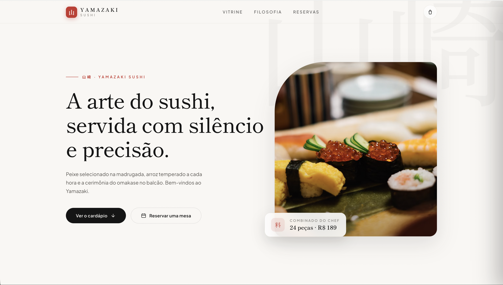

# Yamazaki Sushi 🍣
**A arte do sushi, servida com silêncio e precisão.**
## Descrição
O **Yamazaki Sushi** é uma aplicação web de apresentação e reservas desenvolvida com um design minimalista, elegante e focado na experiência do utilizador. Esse projeto transmite a sofisticação da culinária japonesa tradicional, destacando elementos como peixe selecionado, rigor artesanal e o conceito de *omakase*.
# Prévia do projeto 📸

# Sobre o projeto
* **Apresentação Visual Sofisticada:** Interface limpa que reflete a filosofia e a estética da alta gastronomia japonesa.
* **Vitrine de Produtos:** Exposição de especialidades (como o *Combinado do Chef*) com detalhes de preço e descrição.
* **Navegação Intuitiva:** Secções dedicadas à filosofia do restaurante, visualização do menu ("Ver o cardápio") e sistema de reservas ("Reservar uma mesa").
* **Design Responsivo:** Adaptado perfeitamente para dispositivos móveis, tablets e computadores.
# Tecnologias 🛠️
Este projeto foi construído do zero utilizando:

* **HTML5** — Estruturação semântica
* **CSS / Tailwind CSS** — Estilização moderna e layout responsivo
* **JavaScript** — Lógica de Programação
* **Git & GitHub** — Gestão e controle de versões

## Aprendizado 📖✍🏽
Durante o desenvolvimento, tive algumas dificuldades com a estrutura do layout e os ajustes visuais, mas fui pesquisando, testando e corrigindo até chegar ao resultado que queria. Foi mais um projeto que me permitiu colocar meus conhecimentos em prática, aprender coisas novas e evoluir um pouco mais no desenvolvimento Front-End.
